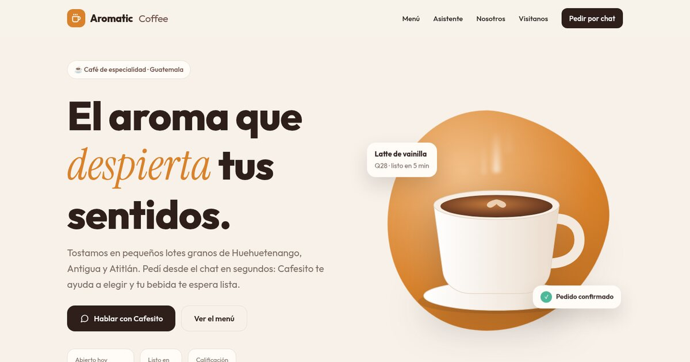

# Aromatic Coffee — plantilla gratis de cafetería con asistente

Landing page para una cafetería de especialidad con **asistente de chat** para pedidos. **Gratis y open source (MIT).**

**Demo:** https://aromatic.neuralcodelab.com

## Qué incluye

- Portada con taza ilustrada y vapor animado, menú con pestañas (calientes, frías, café en grano), sección del asistente
  con conversación de ejemplo, historia, horario y ubicación.
- **Cafesito**, un chat que funciona sin servidor: responde con botones rápidos (menú, recomendaciones, horario)
  y arma el pedido por **WhatsApp**.
- **Listo para Dialogflow:** si tenés un agente de Dialogflow ES, seguí el comentario al final de `index.html`
  para cambiar a Dialogflow Messenger (los colores ya están en el CSS).
- HTML, CSS y JavaScript puros, responsive y accesible.

## Personalizar

1. **Textos, menú y precios:** `index.html` y el objeto `MENU` en `js/main.js`.
2. **Respuestas del asistente:** función `recibir()` en `js/main.js`.
3. **WhatsApp:** constante `WHATSAPP` en `js/main.js`.
4. **Colores:** variables al inicio de `css/styles.css`.

## Publicar

Sitio estático: Cloudflare, GitHub Pages, Netlify o cualquier hosting. Este repo usa `npx wrangler deploy`.

---

Hecho por [NeuralCodeLab](https://neuralcodelab.com/plantillas-gratis) · Más plantillas gratis en neuralcodelab.com
